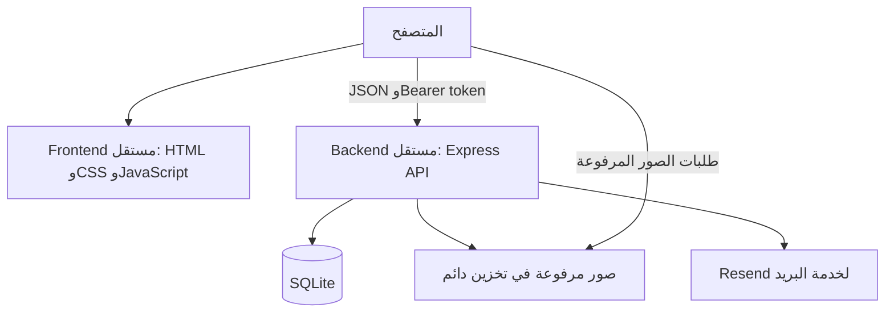

# تقرير فحص وفصل مشروع NANA SECRET

## نطاق الفحص

تمت مراجعة هيكل الملفات، إعدادات npm، سيرفر Express ومساراته، اتصالات JavaScript، لوحة التحكم، نموذج التواصل، مسارات الصور، وطرق التشغيل. لا يشمل هذا التقرير اختبار اختراق شاملًا أو مراجعة تصميم مرئية على أجهزة مختلفة.

## البنية قبل الفصل

- صفحات HTML ثابتة مع CSS وJavaScript بدون إطار واجهات أو خطوة بناء.
- Express وSQLite؛ معظم منطق قاعدة البيانات والتحقق ومسارات API في `server.js` واحد.
- API للأخبار والمنتجات والمستخدمين والمحتوى ومعرض الصور والترتيب والإحصائيات.
- تسجيل دخول يعيد Bearer token، محفوظ في `sessionStorage` على الواجهة وMap في ذاكرة السيرفر.
- رفع صور Base64 وتحويلها إلى ملفات داخل `uploads`؛ قاعدة البيانات تحفظ المسار.
- Resend لإرسال نموذج التواصل باستخدام `fetch` من Node.
- ارتباط الواجهة ضمنيًا بنفس origin للسيرفر، مع تكرار منطق API base في عدة ملفات.
- نموذج التواصل كان يستخدم `/api/contact` مباشرة، وبالصفحة معالج قديم إضافي يرسل إلى `/`.

## المشكلات التي عولجت ضمن الفصل

### 1. إتاحة مجلد المشروع بالكامل

كان `express.static(ROOT)` يعرض جذر المشروع، بما فيه ملفات مصدر السيرفر وملف SQLite، ما دام المسار مطلوبًا بالاسم. Express يمنع dotfiles افتراضيًا، لكن هذا لا يحمي ملفات قاعدة البيانات والمصدر غير المخفية.

أصبح الباك إند يعرض API و`/uploads` فقط. السيرفر الاختياري للفرونت إند يعرض صفحات HTML و`/assets` فقط. تمت إضافة اختبارات تتأكد من أن طلب قاعدة البيانات والمصدر والإعدادات يعيد 404.

### 2. اعتماد الواجهة على مكان السيرفر

أصبح `frontend/assets/js/config.js` المصدر المشترك لعنوان API. تم تعديل جميع المستهلكين، بما في ذلك نموذج التواصل والملفات الإدارية القديمة، مع الإبقاء على التوكن وعقود JSON الحالية.

### 3. الصور بعد اختلاف الدومين

المسارات `/uploads/...` و`uploads/...` تُحوّل عند العرض إلى عنوان الباك إند. صور `assets/images/...` تبقى تابعة للواجهة. المعالجة تشمل المنتجات والأخبار والمعرض وتخصيص الصور ومعاينات الإدارة، بدون إعادة كتابة البيانات الأصلية.

### 4. CORS مفتوح

استُبدل `*` بقائمة origins محددة بمتغير `FRONTEND_ORIGINS`. طلبات origins غير المسموحة تعيد 403، وطلبات preflight تسمح بترويسة `Authorization`. يتم ضبط `Vary: Origin`. هذا ليس بديلًا عن المصادقة، ولا يمنع اتصال أدوات أو سيرفرات لا ترسل Origin.

### 5. نموذج تواصل مكرر

تم حذف المعالج القديم الذي يرسل إلى `/`، والإبقاء على إرسال JSON إلى API المهيأ. تم اختبار تحميل سكريبتات صفحة التواصل بالترتيب والتحقق من إرسال واحد.

## البنية الحالية

يظل منطق API في `backend/server.js`، مع عزل إعداداته في `backend/config.js`. لم تتم إعادة كتابة السيرفر إلى controllers/services أو تغيير إطار الواجهة؛ الفصل هنا بين التطبيقين ومسؤوليتهما، وليس إعادة هيكلة شاملة لمنطق الأعمال.

لكل تطبيق `package.json` و`package-lock.json` مستقلان. يمكن تثبيت وتشغيل ونشر أي منهما دون ملفات التطبيق الآخر. أدوات الجذر تسهّل تشغيلهما معًا محليًا فقط.

## الحفاظ على البيانات والتوافق

- نقل SQLite وملف seed والصور المرفوعة إلى `backend/`.
- نقل صفحات HTML وCSS والصور والسكريبتات إلى `frontend/`.
- عدم تغيير الجداول أو معرفات السجلات أو روابط الصور المحفوظة بسبب الفصل.
- الإبقاء على أسماء مسارات API وطريقة Bearer الحالية.
- نقل قاعدة البيانات لا يستدعي إعادة seed أو نسخ سجلات؛ تظل إجراءات التهيئة القديمة عند بدء السيرفر كما هي.
- `SESSION_SECRET` جزء من خوارزمية تجزئة كلمات المرور الحالية؛ يجب الحفاظ على قيمته أثناء النقل، وعدم تغييره اعتباطيًا.
- `npm start` من الجذر أصبح للـAPI فقط؛ الموقع على المنفذ 3000 عبر `npm run frontend` أو `npm run dev`.

## ملاحظات متبقية قبل الإنتاج

| الأولوية | الملاحظة | التوصية |
| --- | --- | --- |
| حرجة/عالية حسب تنبيهات الحزم | فحص backend أظهر 12 تنبيه اعتماديات: 2 حرجة، 7 عالية، 1 متوسطة، 2 منخفضة | مراجعة كل مسار اعتماد وتحديثه تدريجيًا مع الاختبارات؛ بعض الاعتماديات اختيارية/خاصة بالتثبيت، فلا يعني العدد وحده أن كل تنبيه قابل للاستغلال أثناء التشغيل |
| عالية | قيم تطوير افتراضية للمدير والسر | إعداد بيانات قوية لقواعد البيانات الجديدة، وتغيير كلمات مرور الحسابات الموجودة عبر إجراء آمن؛ الحفاظ على توافق السر إلى حين ترحيل التجزئة |
| عالية | تجزئة كلمات المرور بـSHA-256 مع سر مشترك، وليس خوارزمية passwords بطيئة ذات salt مستقل | ترحيل تدريجي إلى scrypt أو Argon2 أو bcrypt مع الحفاظ على تسجيل دخول الحسابات الحالية |
| عالية | لا يوجد rate limiting ظاهر على الدخول أو نموذج التواصل | إضافة حدود للمحاولات والإرسال، وحدود مدروسة للطلبات ومراقبة إساءة الاستخدام وتكلفة Resend |
| متوسطة | الجلسات Map بدون انتهاء صلاحية أو تخزين دائم | إضافة عمر للجلسات وإبطال واضح وتخزين مناسب عند التوسع |
| متوسطة | جميع المستخدمين المسجلين يحصلون على صلاحيات الإدارة الحالية | إضافة أدوار وصلاحيات إذا كان التطبيق سيستقبل مستخدمين غير إداريين |
| متوسطة | رفع صور Base64، مع دعم SVG، وحجم JSON يصل إلى 25MB | مراجعة التحقق من المحتوى وتعقيم/منع SVG حسب الحاجة، وتحديد حدود مناسبة أو نقل الرفع إلى تخزين معزول |
| متوسطة | رسائل أخطاء API تعيد تفاصيل الخطأ الداخلية | إخفاء التفاصيل في الإنتاج مع إبقائها في سجلات السيرفر |
| تشغيلية | SQLite والصور محلية، والجلسات في ذاكرة العملية | استخدام تخزين دائم ونسخ احتياطي، وعدم تشغيل عدة نسخ بدون خطة لقاعدة البيانات والجلسات |
| خصوصية | قاعدة البيانات والصور كانت موجودة في Git | مراجعة احتواء البيانات على معلومات حساسة وإدارة النسخ والنسخ الاحتياطية خارج المجلدات العامة؛ لم يُحذف تاريخ Git ضمن هذه المهمة |

لم تُنفذ هذه التغييرات الإضافية حتى لا يتم توسيع مهمة الفصل أو كسر توافق كلمات المرور والبيانات. لا تعتبر النسخة جاهزة أمنيًا للإنتاج بمجرد الفصل.

فحص اعتماديات الواجهة لم يظهر تنبيهات أثناء التنفيذ. نتائج `npm audit` تتغير مع تحديث قاعدة التنبيهات؛ أعد الفحص قبل النشر.

## التحقق

- اختبارات API على قاعدة SQLite ومجلد uploads مؤقتين.
- اختبارات تسجيل الدخول والخروج وطلبات الإدارة وظهور المنتجات المنشورة.
- اختبارات إنشاء وتعديل وحذف المنتجات والأخبار، ورفع صور الأخبار والمعرض ومحتوى الصفحة.
- اختبارات قائمة CORS وpreflight ورفض origins غير المسموحة.
- اختبارات حجب قاعدة البيانات والمصدر وملفات الإعدادات عن HTTP.
- اختبارات واجهة بمحاكاة JavaScript/DOM للتحقق من config والروابط والصور والتواصل وربط لوحة التحكم.
- اختبارات HTTP لسيرفر الواجهة والتحقق من حصر الملفات العامة.

لم يتم إجراء اختبار متصفح E2E أو إرسال بريد حقيقي أو نشر خارجي. هذه خطوات تحقق لاحقة قبل الإطلاق، وليست نتائج مُثبتة لهذا الفحص.
